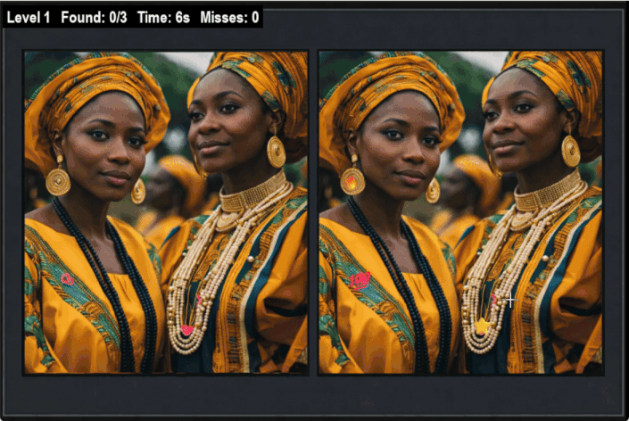
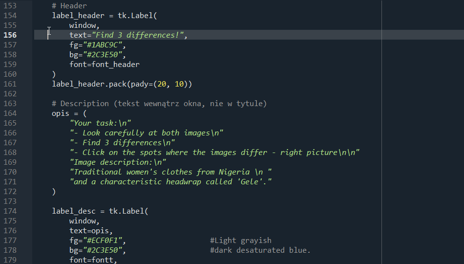
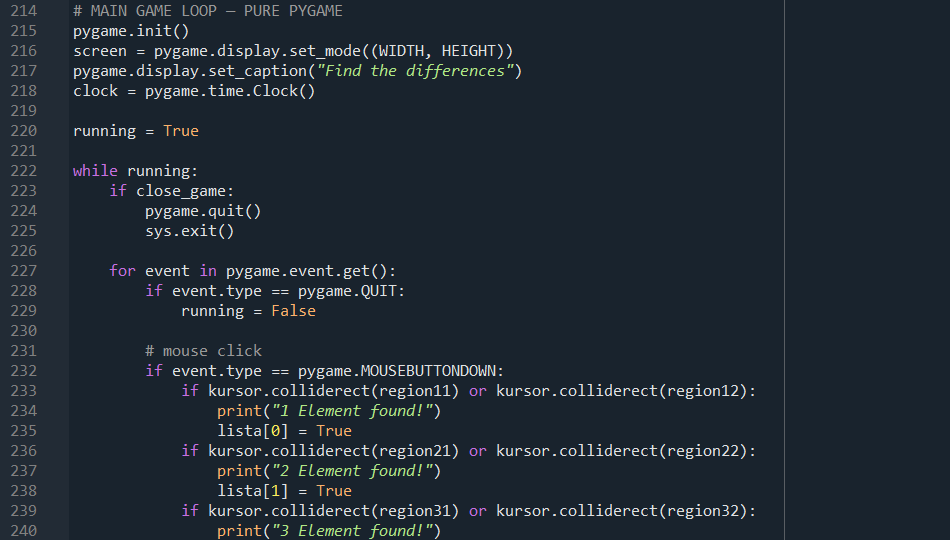

# 🎮 "Find the Differences" Game

This project is a simple Find the Differences puzzle game in which the player compares two nearly identical images and clicks on the areas where they differ. It was created as a learning exercise to practice Python, Tkinter, threading, and creating executable (.exe) files. The game is designed to improve observation and attention to detail. 💡

Technologies

Language: Python

Modules: os, sys, threading, tkinter, pygame, pillow


## 🎮 Game Preview

<p align="center">
  
</p>


⚙️ 1. How to Run?

🔹 Option 1 — Executable (.exe) File
Download the project folder.
Run find_differences.exe.
The game will open in a window. Click the differences in the images to score points.


🔹 Option 2 — Python Source Code (IDE)
Open the project in your preferred IDE (e.g. VS Code, PyCharm).
Make sure you have Python ≥ 3.10 installed, along with the required libraries.
Run:
Shell
python main.py

The game will launch in a Tkinter window.


🕹️ 2. Game Rules
Compare the two images displayed side by side.
Click on the locations where you spot differences.
After finding all differences, you advance to the next level. (planned for an extended version)


🧱 3. Project Structure
Plain Text
Game/
│
├── build/ # Temporary files created during .exe compilation
│
├── dist/ # Folder containing the executable game file
│ └── diff.exe # Game executable
│
├── images/ # Images used in the game
│
├── dif_game_grid.py # Grid tool used to calibrate difference coordinates
├── diff.py # Main game script containing gameplay logic
└── diff.spec # PyInstaller specification file


🔍 4.A Lessons Learned

During the development of this project, I learned several key concepts:

* Adding a coordinate grid tool – I created a coordinate grid overlay that helped me precisely determine the locations of differences in the images. This made player click validation much more accurate.

* Learning Tkinter – I gained a better understanding of event loops, button handling, and working with the Canvas widget.

* Threading – I used a separate thread to track game time and save results without blocking the user interface.

* Debugging and exporting to .exe – After several attempts with PyInstaller, I successfully packaged the game into an executable file and resolved issues related to resources and file paths.


🧩 4.B Improvements Implemented

* While working on the project, I focused on improving the game's functionality and maintainability:

* Improved game loop structure – Screen rendering and restart/exit queue handling now work correctly every frame. The list of discovered differences is generated dynamically ([False] * len(DIFFERENCES)), making it easy to add new differences or levels.

* Game loop moved into a dedicated run_game() function – The main() function first displays the intro window and then starts the game. Previously, the game loop was executed immediately when importing the module.

* Enhanced grid script and new overlay layer – Improved the coordinate calibration tool and added an additional overlay layer for better visualization and debugging.


🧩 5. Future Development

In my free time, I plan to:

* Add more levels with new image pairs.
* Implement a scoring system.
* Extend the project with multiplayer functionality or timed challenges.
* Improve the user interface by adding more colors and visual enhancements 🎉.


💡 6. What Does This Project Demonstrate?

This project is a great example of combining:

* Tkinter – for application window management.
* Pygame Zero / Pygame – for rendering and user interaction.
* Image processing techniques – for identifying and marking differences.
* GUI geometry debugging – through custom calibration tools.
* Packaging Python applications into executable (.exe) files.
* Creating supporting development tools (such as image grid overlays) that streamline the development process.


Code snippet: 



Code snippet: 


<hr style="border:3px solid #AEC6CF;">


### Contact:
[](mailto:kamila.dudzinska@onet.pl)
[](mailto:kamila.dudzinska@onet.pl)
[](https://www.linkedin.com/flagship-web/in/kamila-dudzi%C5%84ska-856bb31b8/)

<br></br>


--------------------------------------------------------------------------------------------------------------------------------------------------------

# 🎮 Gra „Znajdź różnice”


Projekt to prosta gra logiczna typu „znajdź różnice ”, w której gracz porównuje dwa niemal identyczne obrazy i wskazuje miejsca, w których obrazki różnią się od siebie.
Powstała jako ćwiczenie w nauce Python, Tkinter, threading oraz tworzeniu pliku wykonywalnego .exe. Gra ma na celu rozwijanie spostrzegawczości.💡


Technologie: Python


Modules: os, sys, threading, tkinter, pygame, pillow


## 🎮 Podgląd gry

<p align="center">
  
</p>


⚙️ 1. Jak uruchomić?

🔹 Wersja 1 — plik .exe
 ** Pobierz folder projektu.

** Uruchom plik find_differences.exe.

** Gra otworzy się w oknie — klikaj różnice na obrazach, aby zdobywać punkty.


🔹 Wersja 2 — kod w Python (IDE)
** Otwórz projekt w ulubionym IDE (np. VS Code, PyCharm).

** Upewnij się, że masz zainstalowany Python ≥ 3.10 oraz bibliotekę Tkinter.

** Uruchom:

```bash
python main.py
```
Gra wystartuje w oknie Tkinter.


🕹️ 2. Zasady gry
Porównaj dwa obrazy obok siebie.

Kliknij miejsca, w których zauważysz różnice.

Po znalezieniu wszystkich różnic przechodzisz do kolejnego poziomu.* (będzie w wersji rozszwerzonej)


🧱 3. Struktura projektu

Game/

│

├── build/               # Pliki pomocnicze tworzone przy kompilacji do .exe

│

├── dist/                # Folder z gotowym plikiem wykonywalnym gry (.exe)

│   └── diff.exe         # Plik .exe gry

│

├── images/              # Obrazy używane w grze

│

├── dif_game_grid.py     # Skrypt z siatką (gridem) do kalibracji współrzędnych różnic

├── diff.py              # Główny skrypt porównujący obrazy i obsługujący logikę gry

└── diff.spec            # Specyfikacja dla PyInstaller (tworzenie pliku .exe)


🔍 4.A Lessons learned:
Podczas tworzenia projektu nauczyłam się kilku kluczowych rzeczy:

* Dodanie skryptu z gridem — stworzyłam siatkę współrzędnych, która pomogła mi precyzyjnie określić parametry różnic na obrazach. Dzięki temu kliknięcia gracza są dokładnie weryfikowane.

* Poznanie Tkintera — zrozumiałam, jak działa pętla zdarzeń, obsługa przycisków i Canvas.

* Threading — wykorzystałam wątek do mierzenia czasu gry i zapisu wyników bez blokowania interfejsu.

* Debugowanie i eksport do .exe — po kilku próbach z pyinstaller udało się poprawnie zapisać grę jako plik wykonywalny, rozwiązując błędy z zasobami i ścieżkami.


🧩4.B Lessons improved:
Podczas pracy nad projektem skupiłam się na poprawie funkcjonalności i działania gry:

* Poprawiona struktura pętli: rysowanie ekranu i obsługa kolejki restart / exit działają w każdej klatce. a lista znalezionych różnic jest tworzona dynamicznie ([False] * len(DIFFERENCES)), więc łatwo dodać kolejne różnice lub poziomy :)

* Pętla gry w osobnej funkcji run_game(): main() najpierw pokazuje okno intro, a potem uruchamia grę. Wcześniej pętla odpalała się przy imporcie modułu.

* poprawa skryptu siatki i dodanie nowej warstwy overlay


🧩 5. Dalszy rozwój:
W wolnym czasie planuję:

* Dodać kolejne levele z nowymi parami zdjęć.

* Wprowadzić system punktacji

* Rozszerzyć projekt o tryb multiplayer lub czasowe wyzwania.

* Ulepszyć interfejs - dodać więcej kolorów🎉.


6. 💡 Co pokazuje ten projekt?
Ten projekt jest świetnym przykładem połączenia:

* Tkinter – do zarządzania oknami aplikacji

* Pygame Zero – do renderowania i interakcji

* Przetwarzania obrazów – do zaznaczania różnic

* Debugowania geometrii GUI

* Pakowania aplikacji Python do pliku .exe

* Tworzenia narzędzi pomocniczych (np. siatki nakładanej na obraz) wspierających proces tworzenia


Code snippet: 


Code snippet: 


<hr style="border:3px solid #AEC6CF;">


### Contact:
[](mailto:kamila.dudzinska@onet.pl)
[](mailto:kamila.dudzinska@onet.pl)
[](https://www.linkedin.com/flagship-web/in/kamila-dudzi%C5%84ska-856bb31b8/)

<br></br>


